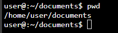
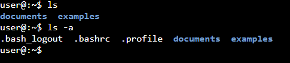
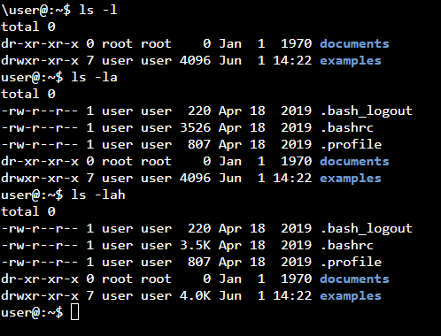
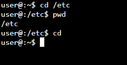
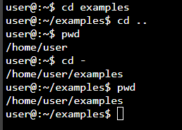
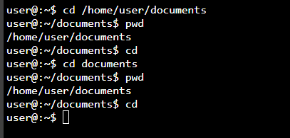

# 01 – Filesystem basics

Format: Task → Command → What happened / What I learned

## Navigation (ls, cd, pwd)

1. Check where you are right after opening the terminal.
   - Command: `pwd`
   - Result: `/home/user/documents`

   

2. List files in your home directory, including hidden ones.
   - Command: `ls -a`
   - What it does: lists all files, including hidden ones (starting with `.`)

   

3. List files with details (permissions, size, date) in human-readable sizes.
   - Command: `ls -l`
     - What it does: lists files with details (permissions, owner, size, date)
     - Note: the date shown by `ls -l` is the last modification time, not the creation time. `ls` doesn't show when a file was created by default.
   - Command: `ls -la`
     - What it does: lists all files, including hidden ones, with details
   - Command: `ls -lah`
     - What it does: same as `ls -la`, but with human-readable sizes (K, M, G)

   

4. Go to `/etc`, check your location, then return home in the shortest way possible.
   - Command: `cd /etc`
     - What it does: moved me to the `/etc` directory
   - Command: `pwd`
     - Result: `/etc`
   - Command: `cd`
     - What it does: moved me back to my home directory (shortest way)

   

5. Go up one directory, then go back to the previous directory with one short command.
   - Command: `cd examples`
     - What it does: moved me into the `examples` directory
   - Command: `cd ..`
     - What it does: moved me one directory up (parent directory)
   - Command: `cd -`
     - What it does: moved me back to the previous directory I was in
     - Note: `cd -` works like a "back" button. Running it again switches between the last two directories.

   

6. What's the difference between an absolute and a relative path? Show one example of each with `cd`.
   - Absolute path: full path starting from the root `/`. Works from anywhere.
     - Example: `cd /home/user/documents`
   - Relative path: path starting from the current directory. Doesn't start with `/`.
     - Example: `cd documents` (when in `/home/user`)

   

## Summary

A nice refresher after a break from Linux. Nothing really surprised me; it was mostly about reminding myself of some commands. The only new (or completely forgotten) one was `cd -`.
