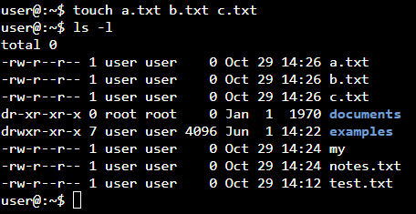
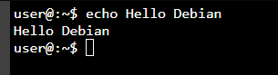
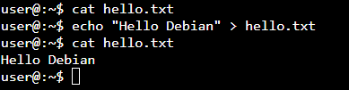
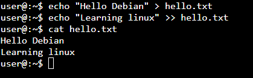
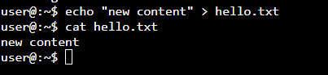
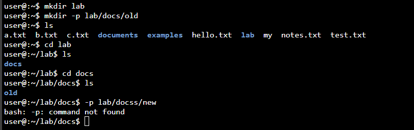
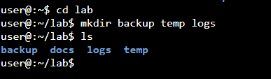
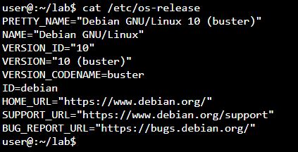
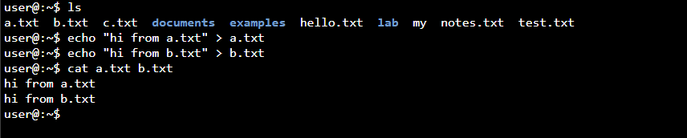

# 02 – Filesystem basics

Format: Task → Command → What happened / What I learned

## Creating & reading (touch, echo, mkdir, cat)

1. Create an empty file `test.txt` and confirm it exists.
   * Command: `touch test.txt`
     * What it does: created an empty file
   * Command: `ls`
     * Result: `test.txt` is listed (white = file)
   * Command: `rm test.txt`
     * What it does: deleted the file
   * Learned: at first I used `mkdir test.txt` by mistake. It created a directory
     named `test.txt` (shown in blue). The `.txt` in a name doesn't make it a file.
     I removed it with `rmdir` and used `touch` instead.

   

2. Create a hidden file `.secret` and check which `ls` command shows it and which doesn't.
   * Command: `touch .secret`
     * What it does: created a hidden file
   * Command: `ls`
     * Result: `.secret` is not listed
   * Command: `ls -a`
     * Result: `.secret` is listed
   * Learned: a file is hidden only when its name starts with a dot.
     A dot in the middle (`secret.secret`) doesn't hide it.

   

3. Create a file named `my notes.txt` (with a space). Check with `ls` whether you got one file or two.
   * Command: `touch my notes.txt`
     * Result: created two separate files: `my` and `notes.txt`
   * Command: `ls -l`
     * Result: `my` and `notes.txt` are listed on separate lines
   * Command: `cd my`
     * Result: `Not a directory` – `cd` works only on directories, not files
   * Learned: a space separates arguments, so `touch` treated the name as two
     different files. A single file with a space in its name would show up
     in quotes in `ls`, e.g. `'my notes.txt'`.

    

4. Create three empty files with one command: `a.txt`, `b.txt`, `c.txt`.
   * Command: `touch a.txt b.txt c.txt`
     * What it does: created three empty files at once
   * Command: `ls -l`
     * Result: `a.txt`, `b.txt` and `c.txt` are listed, each with size 0
   * Learned: the same behaviour that created two files in task 3
     (space = separate arguments) is useful here. One `touch` can create
     many files at once.
    
    
   
5. Print "Hello Debian" on the screen.
   * Command: `echo Hello Debian`
     * Result: `Hello Debian` printed in the terminal
   * Learned: `echo` only displays text, it doesn't create anything.

    
   
6. Write "Hello Debian" into a file `hello.txt`.
   * Command: `echo "Hello Debian" > hello.txt`
     * What it does: sends the text into the file instead of the screen
   * Command: `cat hello.txt`
     * Result: `Hello Debian`
   * Learned: `>` redirects output to a file. The file is created
     automatically if it doesn't exist, so `touch` isn't needed.

   
   
7. Add a second line "Learning Linux" to `hello.txt` without deleting the first one.
   * Command: `echo "Learning linux" >> hello.txt`
     * What it does: appends the text at the end of the file
   * Command: `cat hello.txt`
     * Result: both lines are there: `Hello Debian` and `Learning linux`
   * Learned: `>` overwrites the whole file, `>>` adds to the end of it.

   
   
8. Overwrite `hello.txt` with just "New content". What happened to the old lines?
   * Command: `echo "new content" > hello.txt`
     * What it does: replaces the whole content of the file
   * Command: `cat hello.txt`
     * Result: only `new content` – both old lines are gone
   * Learned: `>` deletes everything in the file before writing, without
     any warning. Be careful with it on important files.
     
    
  
9. Create a folder `lab`, then create the path `lab/docs/old` with one command.
   * Command: `mkdir lab`
     * What it does: created the `lab` directory
   * Command: `mkdir -p lab/docs/old`
     * What it does: created `docs` inside `lab` and `old` inside `docs` at once
   * Command: `cd lab` → `ls` → `cd docs` → `ls`
     * Result: `lab` contains `docs`, and `docs` contains `old`
   * Learned: `-p` creates all missing directories along the path.
     
    
   
11. Create three folders inside `lab` with one command: `backup`, `temp`, `logs`.
   * Command: `mkdir backup temp logs` (inside `lab`)
     * What it does: created three directories at once, side by side
   * Command: `ls`
     * Result: `backup`, `docs`, `logs`, `temp`
   * Learned: at first I used `mkdir -p backup/temp/logs`, which created
     the folders one inside another. `/` means "go inside", while spaces
     separate names, so they end up side by side.
 
  
    
12. Display `/etc/os-release` and find the Debian version.
   * Command: `cat /etc/os-release`
     * Result: Debian GNU/Linux 10 (buster)
   * Learned: `/etc/os-release` holds info about the system version.
     WebVM runs Debian 10, which is no longer supported. The current
     stable release is Debian 13 (trixie).

  
  
13. Display two files at once with one `cat` command.
   * Command: `echo "hi from a.txt" > a.txt` and `echo "hi from b.txt" > b.txt`
     * What it does: put some text into both files first
   * Command: `cat a.txt b.txt`
     * Result: `hi from a.txt` and `hi from b.txt`, one after another
   * Learned: `cat` can take many files and shows them in order.
     The name comes from "concatenate", which means joining together.

  
  
16. Display `hello.txt` with line numbers.
17. Join `a.txt` and `hello.txt` into a new file `joined.txt` using `cat`.

## Scenario: quick note file
Inside `lab/docs`, create a file `notes.txt` containing three lines:
your name, today's date (taken from the system, not typed by hand),
and the current directory path (also from the system).
Then display it to confirm
