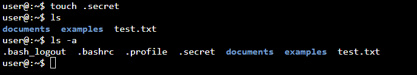
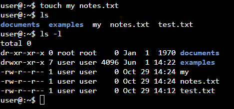

# 02 – Filesystem basics

Format: Task → Command → What happened / What I learned

## Creating & reading (touch, echo, mkdir, cat)

1. Create an empty file `test.txt` and confirm it exists.
   * Command: `touch test.txt`
     * What it does: created an empty file
   * Command: `ls`
     * Result: `test.txt` is listed (white = file)
   * Command: `rm test.txt`
     * What it does: deleted the file
   * Learned: at first I used `mkdir test.txt` by mistake. It created a directory
     named `test.txt` (shown in blue). The `.txt` in a name doesn't make it a file.
     I removed it with `rmdir` and used `touch` instead.

   

2. Create a hidden file `.secret` and check which `ls` command shows it and which doesn't.
   * Command: `touch .secret`
     * What it does: created a hidden file
   * Command: `ls`
     * Result: `.secret` is not listed
   * Command: `ls -a`
     * Result: `.secret` is listed
   * Learned: a file is hidden only when its name starts with a dot.
     A dot in the middle (`secret.secret`) doesn't hide it.

   

3. Create a file named `my notes.txt` (with a space). Check with `ls` whether you got one file or two.
   * Command: `touch my notes.txt`
     * Result: created two separate files: `my` and `notes.txt`
   * Command: `ls -l`
     * Result: `my` and `notes.txt` are listed on separate lines
   * Command: `cd my`
     * Result: `Not a directory` – `cd` works only on directories, not files
   * Learned: a space separates arguments, so `touch` treated the name as two
     different files. A single file with a space in its name would show up
     in quotes in `ls`, e.g. `'my notes.txt'`.

    

5. Create three empty files with one command: `a.txt`, `b.txt`, `c.txt`.
6. Print "Hello Debian" on the screen.
7. Write "Hello Debian" into a file `hello.txt`.
8. Add a second line "Learning Linux" to `hello.txt` without deleting the first one.
9. Overwrite `hello.txt` with just "New content". What happened to the old lines?
10. Create a folder `lab`.
11. Create the path `lab/docs/old` with one command.
12. Create three folders inside `lab` with one command: `backup`, `temp`, `logs`.
13. Display the contents of `hello.txt`.
14. Display `/etc/os-release` and find the Debian version.
15. Display two files at once with one `cat` command.
16. Display `hello.txt` with line numbers.
17. Join `a.txt` and `hello.txt` into a new file `joined.txt` using `cat`.

## Scenario: quick note file
Inside `lab/docs`, create a file `notes.txt` containing three lines:
your name, today's date (taken from the system, not typed by hand),
and the current directory path (also from the system).
Then display it to confirm
