# 03 – Filesystem basics

Format: Task → Command → What happened / What I learned

### Reading parts of a file

1. Create a file `numbers.txt` with the numbers 1 to 20, one per line, without typing them by hand.
   * Command: `seq 1 20 > numbers.txt`
     * What it does: creates numbers.txt with the numbers 1 to 20, one per line.

   

2. Display only the first 5 lines of `numbers.txt`.
   * Command: `head -n 5 numbers.txt`
     * What it does: displays the first 5 lines of numbers.txt.

   

3. Display only the last 3 lines of `numbers.txt`.
   * Command: `tail -n 3 numbers.txt`
     * What it does: displays the last 3 lines of numbers.txt.

   

4. Open `/etc/services` in a pager, scroll down, search for the word `ssh` inside it, then quit.
   * Command: `less /etc/services`
   * Command: `?ssh`
     * What it does: `?ssh` (or `?anything`) searches backwards for that word in a very long document. You leave with `q`.

   

5. Count how many lines, words and characters `hello.txt` has. Then count only the lines.
   * Command: `wc hello.txt`
   * Command: `wc -l hello.txt`
     * What it does: `wc hello.txt` shows 2 4 25, which means the number of lines, words and bytes, followed by the file name. `wc -l` shows only the number of lines.

   

### Information about files

1. Check what type of file `/etc/os-release`, `/bin/ls` and `lab` are, using one command.
   * Command: `file /etc/os-release /bin/ls lab`
     * What it does: checks what kind of file each path is.

   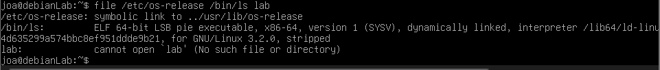

2. Show the size, owner, permissions and last modification time of `hello.txt`.
   * Command: `ls -l hello.txt`
     * What it does: shows the size, owner, permissions and last modification time of hello.txt.

   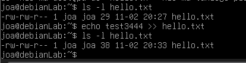

### Copying, moving, renaming, deleting

1. Copy `hello.txt` to `lab/backup/hello_copy.txt`.
   * Command: `cp hello.txt lab/backup/hello_copy.txt`
     * What it does: copies hello.txt into lab/backup and gives the copy a new name, hello_copy.txt. The original hello.txt stays where it was, unchanged.

   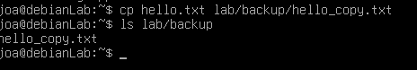

2. Rename `joined.txt` to `combined.txt`.
   * Command: `mv joined.txt combined.txt`
     * What it does: changes the file name. After mv the old name is gone.

   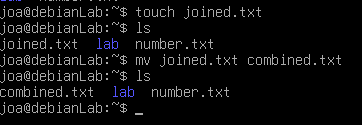

3. Move `combined.txt` into `lab/docs`.
   * Command: `mv combined.txt lab/docs/`
     * What it does: moves combined.txt into the lab/docs directory and keeps its name.
     * Learned: at first lab/docs was a file, not a directory, so `mv combined.txt lab/docs` overwrote that file without any warning instead of moving mine into a folder. mv behaves differently depending on the destination: if it's an existing directory, the file goes inside; if it's an existing file, it gets overwritten; if it doesn't exist, the file is just renamed.

   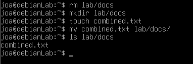

4. Copy the whole `lab/docs` folder (with everything inside) to `lab/docs_backup`.
   * Command: `cp -r lab/docs lab/docs_backup`
     * What it does: copies the docs folder with everything inside into a new folder, docs_backup.

   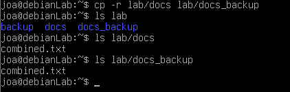

5. Delete a file in a way that asks you for confirmation first.
   * Command: `rm -i plik.txt`
     * What it does: asks for confirmation before deleting each file. On my system (Polish) `t` deletes the file, `n` or just Enter keeps it. On an English system it would be `y` instead of `t`.
     * Learned: rm deletes files immediately and there's no recycle bin in the terminal, so a deleted file can't be restored. -i works as a safety check before removing anything important.

   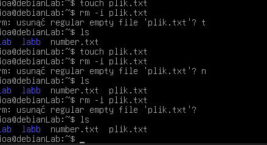

6. Delete the folder `lab/temp`. Then try to delete `lab/docs_backup` the same way. Why does one work and the other not?
   * Command: `rmdir lab/temp`
     * What it does: deletes the folder. It worked because lab/temp was empty.
   * Command: `rmdir lab/docs_backup`
     * What it does: failed with "Directory not empty", because lab/docs_backup still had combined.txt inside.
   * Command: `rm -ri lab/docs_backup`
     * What it does: deletes the folder together with everything inside (-r) and asks for confirmation for each file (-i).
     * Learned: rmdir only removes empty directories, which is why it has no -i option: there's nothing inside to lose. For a folder with files you need rm -r, and adding -i makes it ask before deleting anything.

   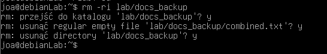

### Writing to files in smarter ways

1. Write a line into `log.txt` and display it on the screen at the same time, with one command.
   * Command: `echo "testujemy" | tee log.txt`
     * What it does: writes the line into log.txt and shows it on the screen at the same time. Running it again on the same file overwrites it, just like `>`.
   * Command: `echo "druga linijka" | tee -a log.txt`
     * What it does: -a adds the line at the end instead of overwriting, just like `>>` (which i tried to use at first but it failed)

   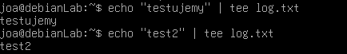
   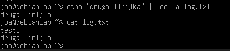
   
2. Create `config.txt` with 3 lines of content using a single command (no editor, no three echos).
   * Command: `printf "pierwsza\ndruga\ntrzecia\n > config.txt`
     * What it does: created config.txt with 3 lines using a single command
    
     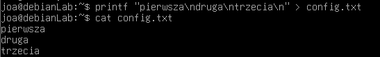

3. Open `config.txt` in `nano`, add a fourth line, save and exit.
  * Command: `nano config.txt`
  * Command: Ctrl + O + Enter
  * Command: Ctrl + X + Enter
     * What it does: turned on nano, wrote fourth line, saved it by using Ctrl O and left nano by using Ctrl X
    
    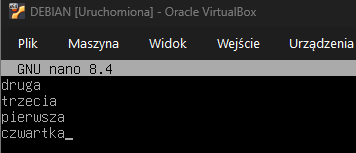
    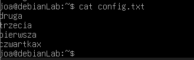
    
4. Display a file where you can see hidden characters like tabs and line endings.
  * Command: `printf "imie\tdzial\nanna\tfinanse\n > tabs.txt`
  * Command: `cat -A tabs.txt `
     * What it does: cat -A shows hidden characters
    
    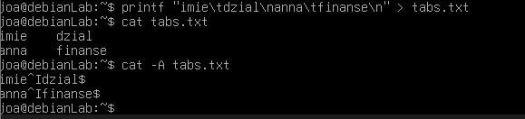
 

Summary: this part felt like I'm finally picking up the pace. Some of it was a refresher, but there was also quite a lot of new stuff for me, like tee, printf, cat -A and searching inside less.
