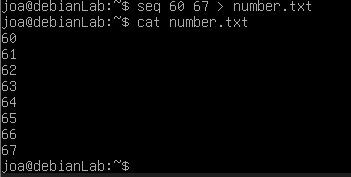
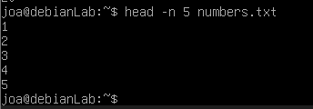
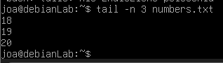
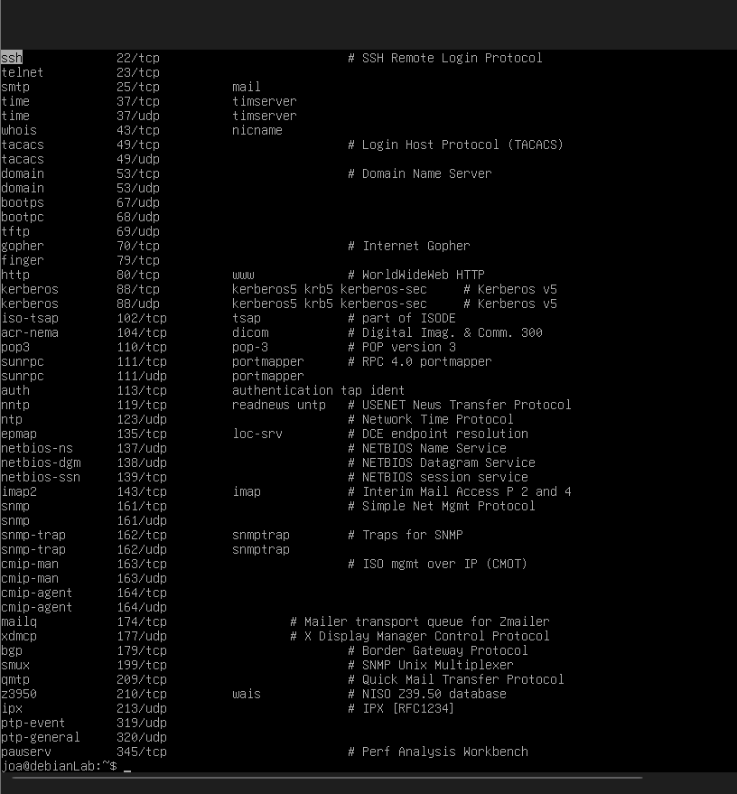
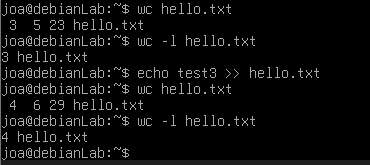

# 03 – Filesystem basics

Format: Task → Command → What happened / What I learned

### Reading parts of a file
1. Create a file `numbers.txt` with the numbers 1 to 20, one per line, without typing them by hand.
   * Command: `seq 1 20 > numbers.txt`
     * What it does: created a file numbers.txt that counts 1 to 20 one per line.
    
     

3. Display only the first 5 lines of `numbers.txt`.
   * Command: `head -n 5 numbers.txt`
     * What it does: displays first 5 lines of numbers.txt
    
     
    
5. Display only the last 3 lines of `numbers.txt`.
   * Command: `tail -n 3 numbers.txt`
     * What it does: displays 3 last lines of numbers.txt
    
     
   
4. Open `/etc/services` in a pager, scroll down, search for the word `ssh` inside it, then quit.
   * Command: `less /etc/services`
   * Command: `?ssh`
     * What it does: ?ssh or ?anything lets you find that one thing you are searching for in a very long doccument.       you leave by using `q`
    
     
     
6. Count how many lines, words and characters `hello.txt` has. Then count only the lines.
   * Command: `wc hello.txt`
   * Command: `wc -l hello.txt`
     * What it does: wc hello.txt shows 2 4 25, which means the number of lines, words and bytes, followed by the         file name. wc -l shows only the number of lines.
    
     

### Information about files
1. Check what type of file `/etc/os-release`, `/bin/ls` and `lab` are, using one command.
2. Show the size, owner, permissions and last modification time of `hello.txt`.
3. Run `touch` on an existing file `hello.txt`. What changed and what didn't? Prove it.

### Copying, moving, renaming, deleting
1. Copy `hello.txt` to `lab/backup/hello_copy.txt`.
2. Rename `joined.txt` to `combined.txt`.
3. Move `combined.txt` into `lab/docs`.
4. Copy the whole `lab/docs` folder (with everything inside) to `lab/docs_backup`.
5. Delete a file in a way that asks you for confirmation first.
6. Delete the folder `lab/temp`. Then try to delete `lab/docs_backup` the same way. Why does one work and the other not?

### Writing to files in smarter ways
7. Write a line into `log.txt` and display it on the screen at the same time, with one command.
8. Create `config.txt` with 3 lines of content using a single command (no editor, no three echos).
9. Open `config.txt` in `nano`, add a fourth line, save and exit.
10. Display a file where you can see hidden characters like tabs and line endings.
