# 04 – Users, groups, permissions

Format: Task → Command → What happened / What I learned

### Who am I

1. Check which user you are logged in as, and what your user ID and groups are.
   * Command:`id`
     * What it does:shows which user I am logged in as, what's my user Id and groups are
     
       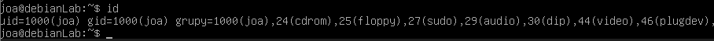

2. Find your own user in `/etc/passwd` and explain what each part of the line means.
   * Command: `cat /etc/passwd`
   * Command: `grep joa /etc/passwd`
     * What happened: cat printed a long list of all accounts on the system,
    so I used grep to show only the line with my user:
    joa:x:1000:1000:joa,,,:/home/joa:/bin/bash

       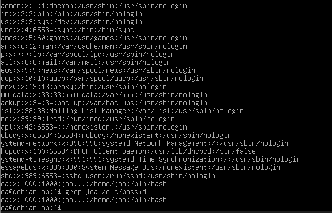

3. Try to read `/etc/shadow` as a normal user, then with sudo. What's the difference and why?
   * Command:`cat /etc/shadow` > Permission denied
   * Command: `sudo cat /etc/shadow` > asked for MY password 
     * What it does: /etc/shadow stores password hashes so only root can read it
      * sudo asks for the user's own password not root's (user must be in the sudo group)
      * "*" or "!" in the password field = no password login possible (system accounts)
      * dates are counted in days since 1 Jan 1970 (20759 = 2 Nov 2026)
      * **never publish your own hash** 

### Creating and managing users

4. Create a new user `ola` with a home directory. Check that the home directory exists.
   * Command: `sudo adduser ola`
    * Command: `getent passwd ola`
    * Command: `ls -ld /home/ola`
    * What happened: adduser asked for a password and some optional info,
      getent showed the new account (UID 1001, home /home/ola),
      ls confirmed the home directory exists and belongs to ola

      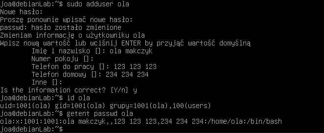
      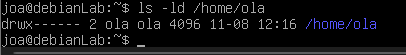

5. Switch to `ola`, check where you are and who you are, then go back to your own user.
   * Command:`su - ola`
   * Command:`pwd`
     * What it does:su - <user> switches user and loads their environment
       
       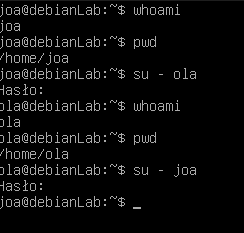

6. Change the password of `ola`.
   * Command:`sudo passwd ola`
     * What it does: changes the password
    
        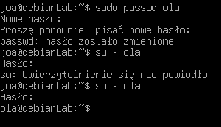

### Groups

7. Create a group `finance` and add both your user and `ola` to it. Check that it worked.
   * Command:`sudo groupadd finance`
   * Command:`sudo usermod -a -G finance user`
   * Command: `getent group finance`
     * What it does:-a (append) is essential: without it -G REPLACES all user's groups

       
        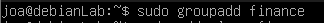
        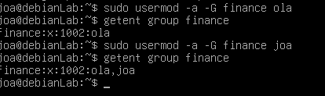

8. Find the `finance` group in `/etc/group`. Who is listed as a member?
   * Command:`grep finance /etc/group`

     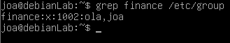

9. Remove `ola` from the `finance` group without deleting the user.
   * Command:`gpasswd -d ola finance `
     * What it does:deletes the user from a group

       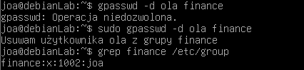
       
### Reading permissions

10. Run `ls -l` on a file and explain every part of the permissions, for example `-rw-r--r--`.
    * Command: `ls -l`
  * What it does: the first character is the file type, then the permissions
    for the owner, the group and others. For example, for config.txt the owner
    can read and write, so can the group, but others can only read. lab has
    a "d" marker, which means it's a directory. The owner has full access,
    so does the group, but others can only read and execute.

    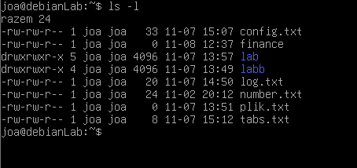

```
-    rw-    rw-    r--
│    │      │      └── others
│    │      └── group
│    └── user/owner
└── type: - = file, d = directory
```

11. Compare the permissions of a file and a directory. What does the first character tell you?
    * Command:`ls -l`
      * What it does:"-" is a normal basic file, "d" is a directory

     

### Changing permissions

12. Create `secret.txt` and make it readable and writable only by you.
    * Command: `chmod 600 secret.txt `

      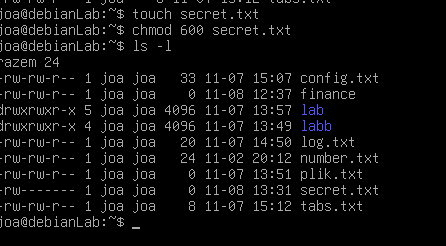

13. Create a script `script.sh`, try to run it, then give it permission to run and try again.
    * Command:`nano script.sh`
    * Command: `echo "hello", ls -l`
    * Command: `chmod +x script_name.sh`
    * Command: `./script.sh`

      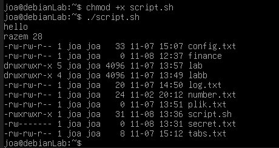
      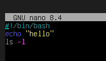

14. Switch to `testuser` and try to read your `secret.txt`. What happens?
    * Command:
      * What it does:

### Ownership

15. Create a file as yourself and change its owner to `testuser` and its group to `projekt`.
    * Command:
      * What it does:

16. Try to change the owner of a file without sudo. Why doesn't it work?
    * Command:
      * What it does:

### Special cases

18. Look at the permissions of `/tmp`. What does the `t` at the end mean, and why is it there?
    * Command:
      * What it does:

19. Check your default permissions for new files. Create a file and a folder and compare their permissions.
    * Command:
      * What it does:

### Everyday admin basics

20. Check whether a user exists and show their account info without opening `/etc/passwd` by hand.
    * Command:
      * What it does:

21. Show which group is a user's primary group and which ones are secondary. What's the difference?
    * Command:
      * What it does:

22. Add a user to a group, then check their groups in a session that was already open. Why doesn't the new group show up right away, and how do you fix it?
    * Command:
      * What it does:

23. Look at `/etc/skel`. What is it for, and what happens to its contents when you create a new user?
    * Command:
      * What it does:

24. Set a password policy for `testuser`: the password must be changed every 90 days, with a warning 7 days before. Show the account's password info.
    * Command:
      * What it does:

25. An intern is joining for one month. Create an account that expires automatically on a set date.
    * Command:
      * What it does:

26. Lock `testuser`'s account, check its status, then unlock it.
    * Command:
      * What it does:

27. Create a service account (for a program, not a person) that can't log in. Check which shell it has.
    * Command:
      * What it does:

28. Show who is logged in right now, who logged in recently, and when each user last logged in.
    * Command:
      * What it does:

29. Find all files owned by `testuser` anywhere on the system (useful before deleting an account).
    * Command:
      * What it does:

30. Check who is allowed to use sudo, and edit the sudo rules the safe way. Why should you never edit that file with a normal editor?
    * Command:
      * What it does:

31. Give one extra user read access to a file without changing its owner or group (ACL). Show the file's ACL.
    * Command:
      * What it does:

### Clean up

32. Delete `testuser` together with their home directory, and delete the `projekt` group.
    * Command:
      * What it does:

Summary:
